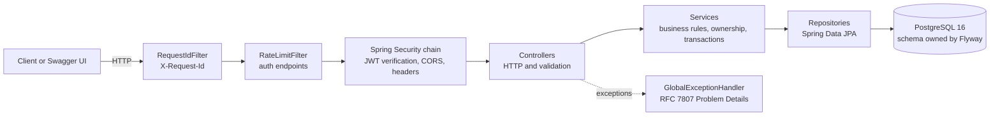
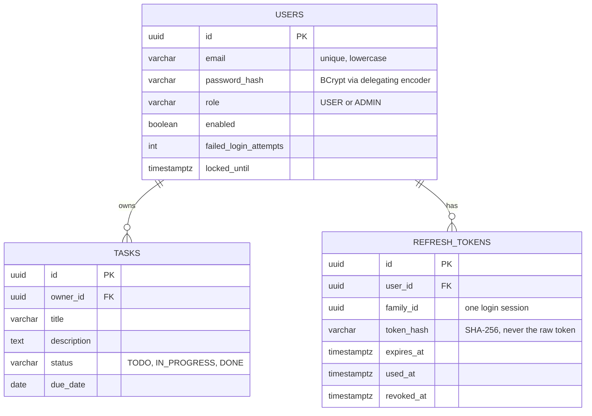
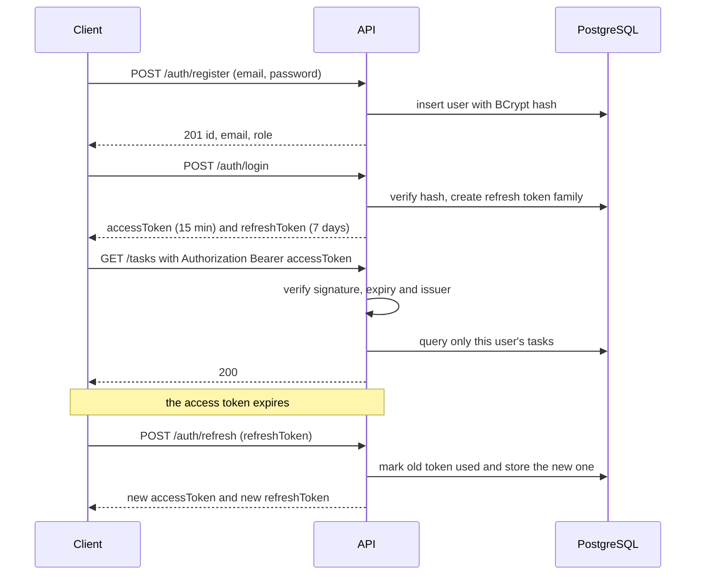
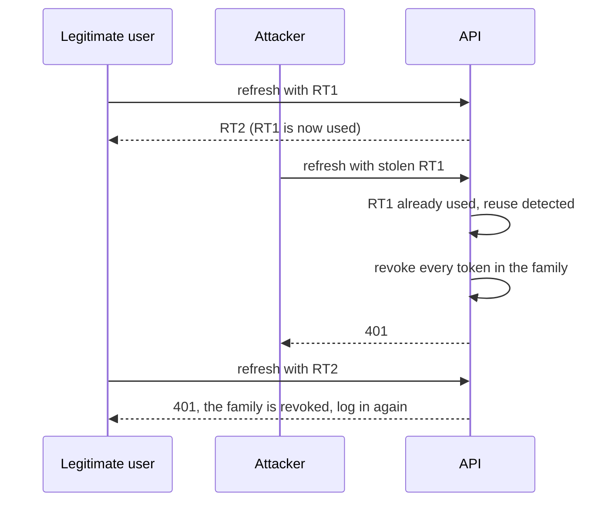
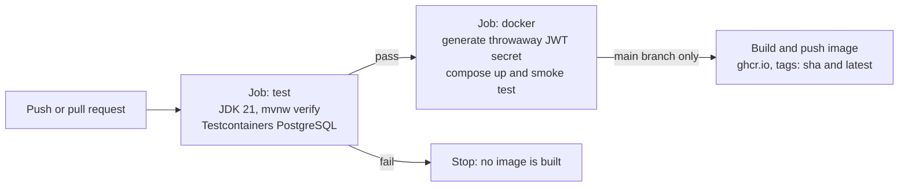

<div align="center">

# TaskFlow API

**A secure, production-minded task management REST API: JWT authentication with rotating refresh tokens, per-user data isolation, role-based access, brute-force protection, and a fully automated test and delivery pipeline.**


[Quick start](#quick-start) · [Security model](#security-model) · [API reference](#api-reference) · [Architecture](#architecture) · [Concepts explained](#concepts-explained) · [Design decisions](#design-decisions-and-trade-offs) · [Troubleshooting](#troubleshooting)

</div>

---

## For reviewers: the 60-second version

```bash
git clone https://github.com/James-oss796/taskflowAPI.git
cd taskflowAPI
cp .env.example .env
openssl rand -base64 32        # copy the output into .env as JWT_SECRET=...
docker compose up --build
```

Open **http://localhost:8080/swagger-ui/index.html**, register, log in, click **Authorize**, and paste the access token to try every endpoint.

  


| What a production backend needs | Where it lives in this repo |
|---|---|
| Layered design, DTO boundary, validation, RFC 7807 errors | `task/`, `common/exception/` |
| Password hashing (BCrypt, delegating encoder, timing-attack defence) | `auth/AuthService`, `security/PasswordConfig` |
| Stateless JWT access tokens and the Spring Security filter chain | `security/` |
| Rotating refresh tokens with reuse detection (stored as hashes) | `auth/token/` |
| Per-user data isolation and roles (BOLA/IDOR protection) | `task/TaskService`, `user/`, `security/AuthenticatedUser` |
| Brute-force defences: rate limiting and account lockout | `security/RateLimitFilter`, `AuthService` |
| Security headers, CORS, secrets from the environment, fail-fast config | `security/SecurityConfig`, `JwtConfig` |
| Versioned database migrations and indexes | `src/main/resources/db/migration/` |
| Tests against a real PostgreSQL, including security regression tests | `src/test/java/` |
| Containerised build, CI pipeline with an authenticated smoke test, published image | `Dockerfile`, `.github/workflows/ci.yml` |

## Contents

1. [Tech stack](#tech-stack)
2. [Architecture](#architecture)
3. [Security model](#security-model)
4. [Quick start](#quick-start)
5. [API reference](#api-reference)
6. [Concepts explained](#concepts-explained)
7. [Testing](#testing)
8. [Docker and CI/CD](#docker-and-cicd)
9. [Project structure](#project-structure)
10. [Design decisions and trade-offs](#design-decisions-and-trade-offs)
11. [Troubleshooting](#troubleshooting)
12. [Limitations and roadmap](#limitations-and-roadmap)
13. [Follow the build](#follow-the-build)

---

## Tech stack

| Area | Choice | Why |
|---|---|---|
| Language | Java 21 | Current LTS, records for concise DTOs |
| Framework | Spring Boot 4.x | Industry standard, strong ecosystem |
| Security | Spring Security, OAuth2 resource server (Nimbus JWT) | Framework-verified tokens instead of hand-written verification |
| Persistence | Spring Data JPA (Hibernate), PostgreSQL 16 | Productive data access, strict relational model |
| Migrations | Flyway | Versioned, reviewable schema changes |
| API docs | springdoc-openapi (Swagger UI with a Bearer "Authorize" button) | Docs generated from code |
| Testing | JUnit, Mockito, AssertJ, MockMvc, Spring Security Test, Testcontainers | Fast unit tests plus realistic integration tests |
| Packaging | Docker (multi-stage), Docker Compose | Reproducible runs |
| CI/CD | GitHub Actions, GitHub Container Registry | Every push is built, tested and smoke-tested |

---

## Architecture

### Layers and the security filter chain



### Data model



---

## Security model

### Authentication flow



### Refresh token rotation and reuse detection

Every refresh token works exactly once. If a spent token is presented again, it has been copied, so the whole session family is revoked.



### Threats and defences

| Threat | Defence |
|---|---|
| Database leak exposes passwords | BCrypt (salted, slow) via a delegating encoder that supports algorithm upgrades |
| Database leak exposes sessions | Refresh tokens stored only as SHA-256 hashes |
| Stolen access token | Short lifetime (15 minutes), stateless verification |
| Stolen refresh token | Single-use rotation plus family revocation on reuse |
| Password guessing | Per-IP rate limiting (HTTP 429) and per-account lockout after 5 failures for 15 minutes |
| Account enumeration | One identical error for unknown email, wrong password, locked and disabled accounts, plus equal BCrypt work for every attempt |
| Reading or changing another user's data (BOLA/IDOR) | Every task query is scoped to the caller. Other users' tasks return `404`, never `403` |
| Privilege escalation | Roles come from the signed token. Admin endpoints require `ROLE_ADMIN`. No public way to become admin |
| Secret leakage | `JWT_SECRET` only from the environment, no default, app refuses to start without it. Credentials masked in `toString()` and never logged |
| Cross-origin abuse | Explicit CORS allow-list, no wildcard |
| Token theft via caching or sniffing | `Cache-Control: no-store` on API responses, `nosniff`, `Referrer-Policy`, HSTS over HTTPS |

### Authorization rules

| Endpoint group | Anonymous | USER | ADMIN |
|---|---|---|---|
| `POST /auth/register`, `/auth/login`, `/auth/refresh`, `/auth/logout` | yes | yes | yes |
| `GET /actuator/health`, Swagger UI, OpenAPI document | yes | yes | yes |
| `GET /auth/me` | no | yes | yes |
| `/tasks` (create, read, update, delete, search) | no | own tasks only | all tasks |
| `GET /admin/users` | no | `403` | yes |

---

## Quick start

### Prerequisites

| Tool | Needed for | Check |
|---|---|---|
| Docker Desktop (or Docker Engine with Compose v2) | Running the app and the integration tests | `docker --version` |
| JDK 21 | Only for local development without Docker | `java -version` |
| Git | Cloning | `git --version` |

### Configure secrets

The app refuses to start without a signing secret, and there is deliberately no default.

```bash
cp .env.example .env
openssl rand -base64 32      # paste the output after JWT_SECRET= in .env
```

<details>
<summary>Generating the secret on Windows PowerShell</summary>

```powershell
Copy-Item .env.example .env
$b = New-Object byte[] 32; [Security.Cryptography.RandomNumberGenerator]::Create().GetBytes($b); [Convert]::ToBase64String($b)
```

</details>

`.env` is gitignored. Never commit it.

### Option A: everything in Docker

```bash
docker compose up --build
```

| URL | What it is |
|---|---|
| http://localhost:8080/swagger-ui/index.html | Interactive API documentation |
| http://localhost:8080/v3/api-docs | OpenAPI document |
| http://localhost:8080/actuator/health | Health check |

```bash
docker compose down        # stop, keep data
docker compose down -v     # stop and delete the database volume
```

### Option B: develop locally (database in Docker, app on your machine)

```bash
docker compose up -d db
export JWT_SECRET="<your generated secret>"
./mvnw spring-boot:run
```

On Windows PowerShell: `$env:JWT_SECRET = "<secret>"` then `.\mvnw.cmd spring-boot:run`.

### Run the tests

```bash
./mvnw verify
```

Docker must be running: the integration tests start PostgreSQL with Testcontainers. Tests use their own throwaway secret from `application-test.yml`.

### Configuration

| Variable | Default | Purpose |
|---|---|---|
| `JWT_SECRET` | none, **required** | Base64 of at least 32 random bytes, used to sign access tokens |
| `DB_URL` | `jdbc:postgresql://localhost:5432/taskflow` | JDBC connection string |
| `DB_USER`, `DB_PASSWORD` | `taskflow` | Database credentials (throwaway local values) |
| `ADMIN_EMAIL`, `ADMIN_PASSWORD` | empty | Optional bootstrap admin created at startup if the email is unused (password must be 12+ characters) |
| `CORS_ALLOWED_ORIGINS` | `http://localhost:5173` | Comma-separated list of browser origins allowed to call the API |
| `SWAGGER_ENABLED` | `true` | Set to `false` in production to hide the docs |

Other tunables (`app.rate-limit.*`, `app.login-protection.*`, token lifetimes) are in `application.yml`.

### Run the published image

```bash
docker pull ghcr.io/james-oss796/taskflowapi:latest

docker run --rm -p 8080:8080 \
  -e JWT_SECRET="<your generated secret>" \
  -e DB_URL=jdbc:postgresql://host.docker.internal:5432/taskflow \
  -e DB_USER=taskflow -e DB_PASSWORD=taskflow \
  ghcr.io/james-oss796/taskflowapi:latest
```

Expects the database from `docker compose up -d db`. If the package is private, run `docker login ghcr.io` first.

---

## API reference

Base path `/api/v1`. The version is part of the URL so breaking changes can ship as `/v2`.

### Auth

| Method | Path | Auth | Description | Success | Errors |
|---|---|---|---|---|---|
| `POST` | `/auth/register` | none | Create an account | `201` | `400`, `409`, `429` |
| `POST` | `/auth/login` | none | Exchange credentials for tokens | `200` | `400`, `401`, `429` |
| `POST` | `/auth/refresh` | refresh token | Rotate: new access and refresh tokens | `200` | `400`, `401`, `429` |
| `POST` | `/auth/logout` | refresh token | Revoke the whole session | `204` | `400` |
| `GET` | `/auth/me` | Bearer | Identity carried by the token | `200` | `401` |

### Tasks (Bearer token required, scoped to the caller)

| Method | Path | Description | Success | Errors |
|---|---|---|---|---|
| `POST` | `/tasks` | Create a task owned by the caller | `201` with `Location` | `400`, `401` |
| `GET` | `/tasks` | Search with filters, pagination, sorting | `200` | `400`, `401` |
| `GET` | `/tasks/{id}` | Get one task | `200` | `400`, `401`, `404` |
| `PUT` | `/tasks/{id}` | Update a task | `200` | `400`, `401`, `404` |
| `DELETE` | `/tasks/{id}` | Delete a task | `204` | `400`, `401`, `404` |

### Admin

| Method | Path | Description | Success | Errors |
|---|---|---|---|---|
| `GET` | `/admin/users?page=0&size=20` | List users | `200` | `401`, `403` |

### Search parameters (`GET /tasks`)

| Parameter | Type | Default | Notes |
|---|---|---|---|
| `status` | `TODO`, `IN_PROGRESS`, `DONE` | none | Exact match |
| `q` | text | none | Case-insensitive "title contains". `%` and `_` are literal |
| `dueBefore` | `YYYY-MM-DD` | none | Due strictly before this date |
| `page` | integer, 0 or more | `0` | Zero-based |
| `size` | integer, 1 to 100 | `20` | Out-of-range values are rejected |
| `sortBy` | `createdAt`, `updatedAt`, `dueDate`, `title`, `status` | `createdAt` | Anything else returns `400` |
| `direction` | `asc` or `desc` | `desc` | |

### Try the whole flow

```bash
BASE=http://localhost:8080/api/v1

curl -s -X POST $BASE/auth/register -H 'Content-Type: application/json' \
  -d '{"email":"demo@example.com","password":"correct-horse-battery"}'

LOGIN=$(curl -s -X POST $BASE/auth/login -H 'Content-Type: application/json' \
  -d '{"email":"demo@example.com","password":"correct-horse-battery"}')
TOKEN=$(echo "$LOGIN" | jq -r .accessToken)
REFRESH=$(echo "$LOGIN" | jq -r .refreshToken)

curl -s -X POST $BASE/tasks -H "Authorization: Bearer $TOKEN" -H 'Content-Type: application/json' \
  -d '{"title":"First task","dueDate":"2030-01-01"}'

curl -s "$BASE/tasks?status=TODO&sortBy=dueDate&direction=asc" -H "Authorization: Bearer $TOKEN"

curl -s -X POST $BASE/auth/refresh -H 'Content-Type: application/json' \
  -d "{\"refreshToken\":\"$REFRESH\"}"

curl -i -X POST $BASE/auth/refresh -H 'Content-Type: application/json' \
  -d "{\"refreshToken\":\"$REFRESH\"}"     # the used token is rejected: 401
```

<details>
<summary>Windows PowerShell equivalents</summary>

```powershell
$base = "http://localhost:8080/api/v1"
$creds = '{"email":"demo@example.com","password":"correct-horse-battery"}'
Invoke-RestMethod -Method Post "$base/auth/register" -ContentType "application/json" -Body $creds
$login = Invoke-RestMethod -Method Post "$base/auth/login" -ContentType "application/json" -Body $creds
$h = @{ Authorization = "Bearer $($login.accessToken)" }
Invoke-RestMethod -Method Post "$base/tasks" -Headers $h -ContentType "application/json" -Body '{"title":"First task"}'
Invoke-RestMethod "$base/tasks?status=TODO" -Headers $h
```

When typing a literal `%` in a URL, encode it as `%25`.

</details>

### Errors

All errors are [RFC 7807 Problem Details](https://www.rfc-editor.org/rfc/rfc7807), so clients parse one shape.

| Status | When |
|---|---|
| `400` | Validation failed, malformed parameter or id (`errors` map lists the fields) |
| `401` | Missing, invalid or expired token, or bad credentials (always the same message) |
| `403` | Authenticated but lacking the required role |
| `404` | Resource does not exist **or belongs to someone else** (deliberately indistinguishable) |
| `409` | Email already registered |
| `429` | Rate limit exceeded (includes a `Retry-After` header) |
| `500` | Unexpected: generic message plus a `requestId` that matches the server log |

<details>
<summary>Example: validation error (400)</summary>

```json
{
  "title": "Invalid request",
  "status": 400,
  "detail": "Validation failed",
  "instance": "/api/v1/auth/register",
  "errors": { "password": "password must be 8 to 72 characters" }
}
```

</details>

---

## Concepts explained

This section explains *why* the code looks the way it does. Each concept follows the same pattern: the problem, the solution, the code, and something you can run. The same ideas recur in every backend system, so learn the pattern, not the syntax.

### 1. Layers and the DTO boundary

**Problem.** Controllers that return database entities couple the API to the schema and leak sensitive columns (a `passwordHash`, an `ownerId` you did not mean to expose).

**Solution.** Each layer has one job, and entities never leave the service layer.

```text
Request DTO -> Controller -> Service -> Repository -> Entity -> DB
                                            |
Response DTO <- Controller <- Service <-----+
```

Request DTOs have no `id`, timestamps or owner, so clients cannot set them. Response DTOs have no password hash, so it cannot leak. Credentials are also masked in `toString()` (`RegisterRequest`, `LoginRequest`, `LoginResponse`, `JwtProperties`), because Java records print every field and one careless `log.info("{}", request)` would otherwise write secrets to the logs.

### 2. Validate at the edge, fail loudly

Constraints live on the request DTOs (`@NotBlank`, `@Size`, `@Email`), and query parameters are strict: `page=abc`, `size=5000` and unknown sort fields all return `400` instead of silently falling back to defaults. Silent defaults hide client bugs.

```bash
curl -i "http://localhost:8080/api/v1/tasks?size=5000" -H "Authorization: Bearer $TOKEN"   # 400
```

### 3. Central error handling (RFC 7807)

Services throw domain exceptions, and one `@RestControllerAdvice` translates them to HTTP. Security filters run before Spring MVC, so their errors never reach the advice. Dedicated handlers (`RestAuthenticationEntryPoint`, `RestAccessDeniedHandler`) keep `401` and `403` in the same shape. Method-level `AccessDeniedException` is handled explicitly in the advice, because the catch-all `Exception` handler would otherwise turn a `403` into a `500`.

### 4. Migrations, not auto-generated schemas

Flyway applies versioned SQL files, and Hibernate only *validates* (`ddl-auto: validate`), so a mismatch between entity and table fails at startup with a precise message. Never edit an applied migration; add the next version.

| Migration | Adds |
|---|---|
| `V1` | `tasks` table |
| `V2` | Indexes for the search filters |
| `V3` | `users` (unique, lowercase-checked email) |
| `V4` | `refresh_tokens` |
| `V5` | `tasks.owner_id` with a foreign key |
| `V6` | Lockout columns on `users` |

### 5. Passwords: slow, salted, upgradable

Passwords are hashed with BCrypt through Spring's delegating encoder, so each hash carries its algorithm prefix (`{bcrypt}...`) and can be migrated to another algorithm later. Plain fast hashes such as SHA-256 are the wrong tool for passwords because they are built to be fast, which lets attackers guess billions of passwords per second.

Login also removes two side channels. Unknown email, wrong password, locked and disabled accounts all return the **same** `401`, and every attempt performs one BCrypt comparison (against a dummy hash when the user does not exist), so response time does not reveal whether an account exists.

### 6. JWT access tokens and the filter chain

```text
header.payload.signature
payload = { sub: <user id>, email, roles: ["USER"], iss, iat, exp, jti }
signature = HMAC-SHA256(header.payload, secret)
```

A JWT is **signed, not encrypted**: anyone can read the payload, but nobody can change it without the key. Tokens live 15 minutes because a stateless token cannot be revoked. Verification is done by Spring Security's resource-server support (signature, expiry, issuer), and the API stays stateless: no session, so CSRF protection is not needed for Bearer tokens in the `Authorization` header.

### 7. Refresh token rotation and reuse detection

Refresh tokens are 256-bit random opaque strings, stored only as SHA-256 hashes (a fast hash is correct here because the token has 256 bits of entropy and must be looked up by hash). Each use consumes the token and issues a successor in the same *family*. Presenting a spent token revokes the entire family.

Two details make this correct:

- **Atomic single use.** The state change is a database compare-and-set (`UPDATE ... WHERE used_at IS NULL`), so two simultaneous requests cannot both succeed.
- **"Write, then throw" needs `noRollbackFor`.** On reuse the service revokes the family and then throws a `401`. A normal rollback would undo the revocation, so the transaction is marked `noRollbackFor`. The same applies to the failed-login counter.

### 8. Authorization: ownership first, roles second

```java
private Task getAccessible(UUID id, AuthenticatedUser user) {
    return repository.findById(id)
            .filter(t -> user.admin() || t.getOwnerId().equals(user.id()))
            .orElseThrow(() -> new ResourceNotFoundException("Task", id));
}
```

Broken object-level authorization (BOLA/IDOR) is the number one API vulnerability: a logged-in user changes an id in the URL and reads someone else's data. Every task query is scoped to the caller, and a task that belongs to someone else returns `404`, the same response as a task that does not exist, so ids reveal nothing. Role checks (`@PreAuthorize("hasRole('ADMIN')")`) come on top for operations that need them.

### 9. Brute-force defences

| Layer | Behaviour |
|---|---|
| `RateLimitFilter` | 10 requests per minute per client IP, per auth endpoint, then `429` with `Retry-After`. Runs before any BCrypt work |
| Account lockout | 5 failed logins lock the account for 15 minutes. A locked account refuses even the correct password and returns the generic `401` |
| Atomic counters | Failure counts use `UPDATE ... SET n = n + 1` and are re-read inside the same transaction, so parallel guesses cannot dodge the counter |

### 10. Secrets and configuration

Everything environment-specific comes from environment variables. The signing secret has no default, must decode to at least 32 bytes, and the app refuses to start otherwise. Error messages never include secret values.

### 11. Pagination, filtering and sorting

Specifications compose optional filters (values are bound parameters, so SQL injection is not possible, and `LIKE` wildcards are escaped). Sort fields are whitelisted. A unique tie-breaker (`id`) keeps ordering deterministic:

```text
rows A B C D share the same due_date, page size 2

without a tie-breaker                      with ORDER BY due_date, id
page 1 -> A B                              page 1 -> A B   (always)
page 2 -> C A   (A repeated, D never)      page 2 -> C D   (always)
```

### 12. Observability

A servlet filter assigns every request an `X-Request-Id` (an incoming id is accepted only if it matches `[A-Za-z0-9-]{8,64}`, which prevents log injection), stores it in the logging context and logs one summary line per request. Security events (failed logins, lockouts, refresh reuse) are logged with user ids, never with passwords, tokens or raw emails.

---

## Testing

```text
        /\          Integration: full app + real PostgreSQL (Testcontainers)
       /  \         validation, SQL, migrations, security rules, status codes
      /----\
     /      \       Unit: one class, collaborators mocked
    /________\      business rules and ownership logic in milliseconds
```

Integration tests run against a disposable PostgreSQL 16, because fakes behave differently from production. Security behaviour is tested as hard as business behaviour:

| Test | Guards against |
|---|---|
| `protectedEndpoint_withoutToken_returns401_withProblemJson` | Accidentally public endpoints |
| `tamperedToken_returns401`, `expiredToken_returns401` | Forged or stale tokens |
| `login_unknownEmailAndWrongPassword_areIndistinguishable` | Account enumeration |
| `register_storesAHash_neverThePlaintext` | Plaintext passwords in the database |
| `database_neverStoresTheRawToken` | Raw refresh tokens in the database |
| `reuseOfAnOldToken_revokesTheWholeFamily` | Refresh token theft, and the rollback-swallows-revocation bug |
| `userSeesOnlyOwnTasks`, `getAnotherUsersTask_returns404_notForbidden` | Cross-user data access (BOLA) |
| `adminEndpoint_asUser_returns403_asProblemJson` | Privilege escalation, and the `403`-becomes-`500` trap |
| `accountLocksAfterFiveFailures_evenForTheCorrectPassword` | Brute force, and the lockout counter surviving the thrown exception |
| `loginIsRateLimited_afterThreeRequests` | Unlimited guessing |
| `corsPreflight_allowsConfiguredOrigin_only` | Overly permissive CORS |
| `pagination_withIdenticalSortValues_neverRepeatsOrSkipsItems` | Unstable page ordering |

```bash
./mvnw verify          # run everything (Docker must be running)
```

---

## Docker and CI/CD

A multi-stage `Dockerfile` keeps build tools and source out of the final image: a JDK stage builds the jar, and a JRE stage runs it as a non-root user with `MaxRAMPercentage=75`. A BuildKit cache mount keeps Maven downloads between builds.



The smoke test runs the **real security flow** against the built container: register, log in, create a task with the Bearer token, refresh the token, confirm the used refresh token is rejected, and confirm an unauthenticated request returns `401`. The pipeline authenticates to the registry with the short-lived `GITHUB_TOKEN`, and the CI signing secret is generated per run and discarded.

---

## Project structure

```text
taskflowAPI/
├── .github/workflows/ci.yml
├── .env.example                          Template for local secrets (.env is gitignored)
├── src/main/java/com/james/taskflow/
│   ├── TaskflowApplication.java
│   ├── auth/
│   │   ├── AuthController.java           register, login, refresh, logout, me
│   │   ├── AuthService.java              credentials, lockout, token issuing
│   │   ├── dto/                          Request and response records
│   │   └── token/                        RefreshToken entity, repository, rotation service, cleanup job
│   ├── user/                             User entity, Role, repository, admin listing
│   ├── security/
│   │   ├── SecurityConfig.java           Filter chain, CORS, headers, rules
│   │   ├── JwtConfig.java, JwtService.java, JwtProperties.java
│   │   ├── RateLimitFilter.java, AuthenticatedUser.java, AdminBootstrap.java
│   │   └── Rest*Handler.java, ProblemJson.java
│   ├── task/                             Entity, controller, service, specifications, DTOs
│   └── common/                           PageResponse, exceptions, RequestIdFilter, OpenAPI config
├── src/main/resources/
│   ├── application.yml
│   └── db/migration/                     V1 to V6
├── src/test/java/...                     Unit and Testcontainers integration tests
├── Dockerfile
├── docker-compose.yml
└── pom.xml
```

---

## Design decisions and trade-offs

| Decision | Why | Trade-off accepted |
|---|---|---|
| Stateless JWT access tokens, 15 minute lifetime | No session store, horizontally scalable | Cannot be revoked early, so lifetimes stay short |
| Opaque, hashed, rotating refresh tokens | Revocable, theft-detecting sessions | A database lookup per refresh |
| HS256 with a shared secret | Simplest correct choice for one service | Services that only verify would need an asymmetric key pair (planned for the microservices project) |
| Spring's resource server for verification | Audited code instead of hand-written verification | Framework coupling |
| `404` for other users' tasks | Ids reveal nothing | Slightly less informative errors |
| Same `401` for every login failure | No account enumeration | Harder to debug login problems (logs have the detail) |
| Account lockout | Stops credential guessing against one account | An attacker can lock someone out, mitigated by short locks and IP rate limits |
| In-memory rate limiter | No extra infrastructure | Per instance only, a shared store replaces it later |
| No Lombok, DTO records | No hidden code generation | A little more mapping code |
| Specifications for filtering | Combinable filters | More code than one fixed query |
| Offset pagination with a tie-breaker | Simple, stable | Deep pages get slower (cursor pagination is the upgrade) |
| Testcontainers, not an in-memory database | Tests run on the real engine | Needs Docker |
| Flyway with `ddl-auto: validate` | Reviewable schema history | Every change needs a migration |

---

## Troubleshooting

<details>
<summary><b>The app will not start: "Could not resolve placeholder 'JWT_SECRET'" or "not valid base64"</b></summary>

`JWT_SECRET` is missing or is not the generated output. Generate one (`openssl rand -base64 32`) and set exactly that single line, with no quotes, spaces or angle brackets. Docker Compose reads it from `.env`, and IntelliJ reads it from the run configuration's environment variables. A command or placeholder pasted by mistake produces `Illegal base64 character`.

</details>

<details>
<summary><b>Everything returns 401</b></summary>

The endpoint needs a Bearer token. Log in, then send `Authorization: Bearer <accessToken>`. Access tokens expire after 15 minutes: use `/auth/refresh`.

</details>

<details>
<summary><b>I get 429 Too Many Requests while testing by hand</b></summary>

Auth endpoints allow 10 requests per minute per IP. Wait for the `Retry-After` seconds, or raise `app.rate-limit.max-requests` locally. Tests use a high limit through `application-test.yml`.

</details>

<details>
<summary><b>My account is locked</b></summary>

Five failed logins lock an account for 15 minutes, and a locked account refuses even the correct password. Wait, or clear it locally: `update users set locked_until = null, failed_login_attempts = 0 where email = '...';`

</details>

<details>
<summary><b>Tests fail with "Could not find a valid Docker environment"</b></summary>

Start Docker Desktop and check `docker ps`. The integration tests need Docker for Testcontainers.

</details>

<details>
<summary><b>Port 5432 is already in use</b></summary>

Stop the local PostgreSQL, or change the host side of the port mapping in `docker-compose.yml` (for example `"5433:5432"`) and set `DB_URL`.

</details>

<details>
<summary><b>Maven downloads time out</b></summary>

That is the connection to Maven Central. Retry on another network or configure a mirror in `~/.m2/settings.xml`. The CI pipeline is unaffected.

</details>

---

## Limitations and roadmap

| Area | Status | Next step |
|---|---|---|
| Browser clients | Refresh token is returned in the JSON body | Move it to an `HttpOnly`, `Secure`, `SameSite` cookie when the React frontend is built, with matching CSRF handling |
| Rate limiting | In-memory, per instance | Redis-backed shared limiter (caching project) |
| Account lifecycle | No email verification, password reset or MFA | Verification and reset flows through an email provider |
| Token signing | HS256 shared secret | Asymmetric keys with key rotation once several services verify tokens |
| Access token revocation | Not possible before expiry | Short lifetimes now, a denylist if needed later |
| Pagination | Offset-based | Keyset (cursor) pagination for very large lists |
| Text search | `LIKE` on title | Full-text search (search project) |
| Metrics | Health probes only | Prometheus metrics and tracing |

---

## Follow the build

The history is written to be read in order. Each step introduces one group of ideas:

| Step | Introduces | Key files |
|---|---|---|
| 1. Foundation | Setup, Docker database, environment config, first migration | `docker-compose.yml`, `application.yml`, `V1` |
| 2. CRUD | Entity, DTOs, validation, central error handling | `task/`, `GlobalExceptionHandler` |
| 3. Search | Pagination, Specifications, sort whitelist, indexes | `TaskSpecifications`, `V2` |
| 4. Testing | Unit and Testcontainers integration tests | `src/test/java/` |
| 5. Operability | OpenAPI, request ids, health probes, multi-stage image | `RequestIdFilter`, `Dockerfile` |
| 6. Delivery | CI pipeline, smoke test, published image | `.github/workflows/ci.yml` |
| 7. Identity | Users table, BCrypt, registration | `V3`, `auth/AuthService` |
| 8. Authentication | Login, JWT, the security filter chain | `security/`, `JwtService` |
| 9. Sessions | Rotating refresh tokens, reuse detection, logout | `V4`, `auth/token/` |
| 10. Authorization | Task ownership, roles, 401 vs 403, BOLA protection | `V5`, `TaskService`, `AdminController` |
| 11. Hardening | Rate limiting, lockout, headers, CORS, cleanup job | `V6`, `RateLimitFilter`, `SecurityConfig` |

---

## Author

Built by **James**, a backend engineer in training working toward remote backend roles. This is part of a series of backend portfolio projects, each practising the same core ideas at a higher level. See the [GitHub profile](https://github.com/James-oss796) for the others.

## License

Released under the [MIT License](LICENSE).
