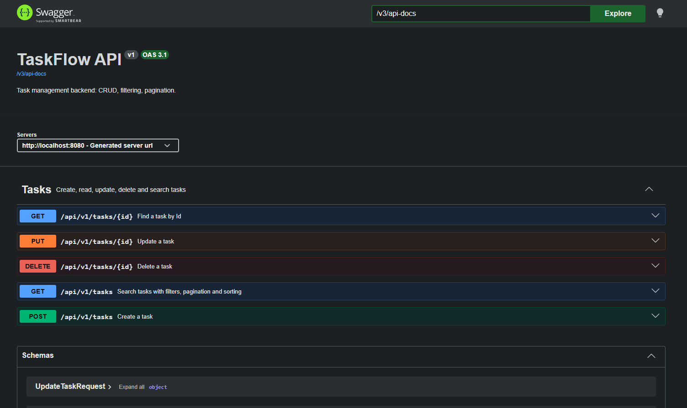
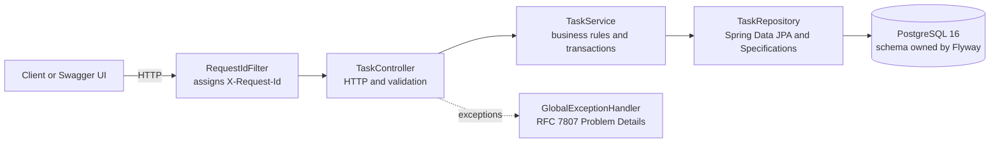
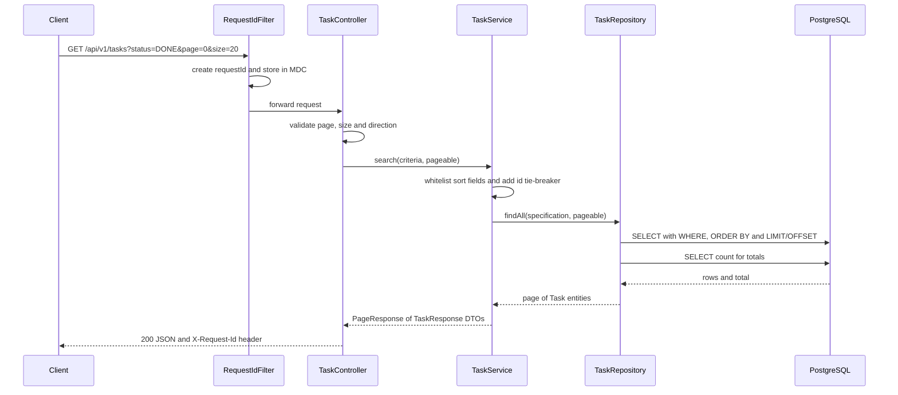
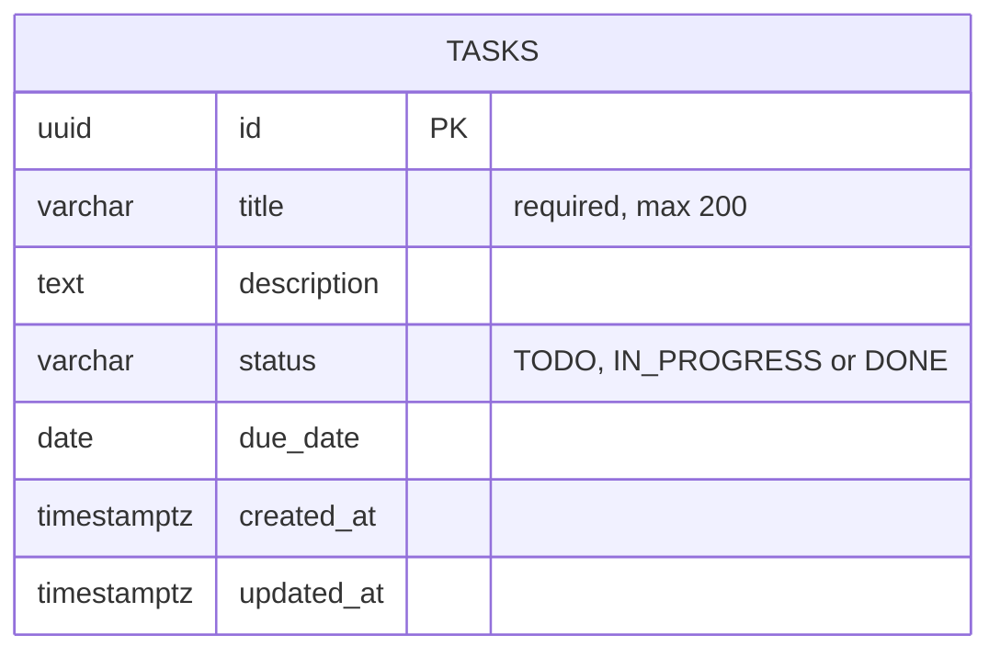
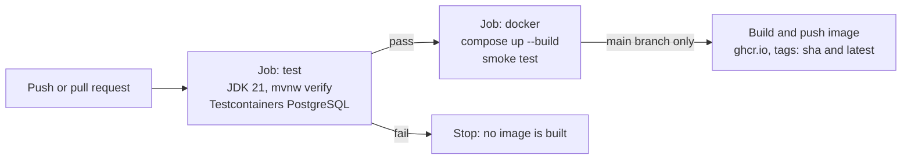

<div align="center">

# TaskFlow API

**A production-minded task management REST API, built to show how a backend is engineered, not just coded: layered design, validated input, versioned migrations, real-database tests, containers and CI.**


[Quick start](#quick-start) · [API reference](#api-reference) · [Architecture](#architecture) · [Concepts explained](#concepts-explained) · [Design decisions](#design-decisions-and-trade-offs) · [Troubleshooting](#troubleshooting)

</div>

---

## For reviewers: the 60-second version

```bash
git clone https://github.com/James-oss796/taskflowAPI.git
cd taskflowAPI
docker compose up --build
```

Then open **http://localhost:8080/swagger-ui/index.html** and try the API from your browser. Nothing else to install except Docker.


  


| What a backend should have | Where it lives in this repo |
|---|---|
| Clear layers (controller, service, repository) and DTOs at the boundary | `src/main/java/com/james/taskflow/task/` |
| REST design: versioned URLs, correct status codes, RFC 7807 errors | `TaskController`, `GlobalExceptionHandler` |
| Versioned database migrations and indexes | `src/main/resources/db/migration/` |
| Dynamic filtering, bounded pagination, deterministic sorting | `TaskSpecifications`, `TaskService.search` |
| Defensive input handling (validation, sort whitelist, `LIKE` escaping, log-injection guard) | `CreateTaskRequest`, `TaskService`, `RequestIdFilter` |
| Observability: request IDs in every log line, health and readiness probes | `RequestIdFilter`, Spring Boot Actuator |
| Tests against a real PostgreSQL (not a fake) | `src/test/java/` with Testcontainers |
| Containerised build, CI pipeline, published image | `Dockerfile`, `docker-compose.yml`, `.github/workflows/ci.yml` |

## Contents

1. [Tech stack](#tech-stack)
2. [Architecture](#architecture)
3. [Quick start](#quick-start)
4. [API reference](#api-reference)
5. [Concepts explained](#concepts-explained)
6. [Testing](#testing)
7. [Docker and CI/CD](#docker-and-cicd)
8. [Project structure](#project-structure)
9. [Design decisions and trade-offs](#design-decisions-and-trade-offs)
10. [Troubleshooting](#troubleshooting)
11. [Limitations and roadmap](#limitations-and-roadmap)
12. [Follow the build](#follow-the-build)

---

## Tech stack

| Area | Choice | Why |
|---|---|---|
| Language | Java 21 | Current LTS, records for concise DTOs |
| Framework | Spring Boot 4.x | Industry standard, strong ecosystem |
| Persistence | Spring Data JPA (Hibernate) | Productive data access, Specifications for dynamic queries |
| Database | PostgreSQL 16 | Reliable, strict, great tooling |
| Migrations | Flyway | Versioned, reviewable schema changes |
| API docs | springdoc-openapi (Swagger UI) | Docs generated from the code, so they stay true |
| Testing | JUnit, Mockito, AssertJ, MockMvc, Testcontainers | Fast unit tests plus realistic integration tests |
| Packaging | Docker (multi-stage), Docker Compose | Reproducible runs on any machine |
| CI/CD | GitHub Actions, GitHub Container Registry | Every push is built, tested and smoke-tested |

---

## Architecture

### Layers

Each layer has one job. Dependencies point downward only, so any layer can be tested or replaced without touching the others.



### One request, end to end

What happens when a client searches for completed tasks:



### Data model



Indexes on `status`, `due_date` and `created_at` (migration `V2`) support the filters and sort orders the API exposes. Indexes are a read/write trade-off, so only columns that queries actually use are indexed.

---

## Quick start

### Prerequisites

| Tool | Needed for | Check |
|---|---|---|
| Docker Desktop (or Docker Engine with Compose v2) | Running the app, and the integration tests | `docker --version` |
| JDK 21 | Only for local development without Docker | `java -version` |
| Git | Cloning | `git --version` |

### Option A: run everything in Docker

```bash
git clone https://github.com/James-oss796/taskflowAPI.git
cd taskflowAPI
docker compose up --build
```

| URL | What it is |
|---|---|
| http://localhost:8080/swagger-ui/index.html | Interactive API documentation |
| http://localhost:8080/v3/api-docs | Raw OpenAPI document (JSON) |
| http://localhost:8080/actuator/health | Health check |

Stop it:

```bash
docker compose down        # stop containers, keep the data
docker compose down -v     # stop containers and delete the database volume
```

### Option B: develop locally (database in Docker, app on your machine)

```bash
docker compose up -d db
./mvnw spring-boot:run
```

On Windows PowerShell use `.\mvnw.cmd spring-boot:run`.

### Run the tests

```bash
./mvnw verify
```

Docker must be running: the integration tests start a throwaway PostgreSQL container with Testcontainers.

### Configuration

The app reads its settings from environment variables, with local-development defaults. Nothing secret is committed. The credentials in `docker-compose.yml` are throwaway values for local use only.

| Variable | Default | Purpose |
|---|---|---|
| `DB_URL` | `jdbc:postgresql://localhost:5432/taskflow` | JDBC connection string |
| `DB_USER` | `taskflow` | Database user |
| `DB_PASSWORD` | `taskflow` | Database password |

### Run the published image

Every push to `main` publishes an image to GitHub Container Registry, tagged with the commit SHA and `latest`.

```bash
docker pull ghcr.io/james-oss796/taskflowapi:latest

docker run --rm -p 8080:8080 \
  -e DB_URL=jdbc:postgresql://host.docker.internal:5432/taskflow \
  -e DB_USER=taskflow -e DB_PASSWORD=taskflow \
  ghcr.io/james-oss796/taskflowapi:latest
```

This expects the database from `docker compose up -d db` to be running. If the package is private, run `docker login ghcr.io` first.

---

## API reference

Base path: `/api/v1`. The version is part of the URL so breaking changes can ship as `/v2` without breaking existing clients.

| Method | Path | Description | Success | Errors |
|---|---|---|---|---|
| `POST` | `/tasks` | Create a task | `201` with `Location` header | `400` |
| `GET` | `/tasks` | Search with filters, pagination, sorting | `200` | `400` |
| `GET` | `/tasks/{id}` | Get one task | `200` | `400` (malformed id), `404` |
| `PUT` | `/tasks/{id}` | Update a task | `200` | `400`, `404` |
| `DELETE` | `/tasks/{id}` | Delete a task | `204` | `400`, `404` |

Operational endpoints: `/actuator/health`, `/actuator/health/liveness`, `/actuator/health/readiness`.

### Search parameters (`GET /tasks`)

| Parameter | Type | Default | Notes |
|---|---|---|---|
| `status` | `TODO`, `IN_PROGRESS`, `DONE` | none | Exact match |
| `q` | text | none | Case-insensitive "title contains". `%` and `_` are treated as literal characters |
| `dueBefore` | date `YYYY-MM-DD` | none | Tasks due strictly before this date |
| `page` | integer, 0 or more | `0` | Zero-based page index |
| `size` | integer, 1 to 100 | `20` | Page size. Out-of-range values are rejected, not silently changed |
| `sortBy` | `createdAt`, `updatedAt`, `dueDate`, `title`, `status` | `createdAt` | Anything else returns `400` |
| `direction` | `asc` or `desc` | `desc` | |

### Try it

Create a task:

```bash
curl -s -X POST http://localhost:8080/api/v1/tasks \
  -H "Content-Type: application/json" \
  -d '{"title":"Write README","description":"Make it recruiter-ready","dueDate":"2030-01-01"}'
```

Search, filtered and sorted:

```bash
curl -s "http://localhost:8080/api/v1/tasks?status=TODO&q=readme&sortBy=dueDate&direction=asc&page=0&size=10"
```

Update (replace `<ID>` with the `id` from the create response):

```bash
curl -s -X PUT http://localhost:8080/api/v1/tasks/<ID> \
  -H "Content-Type: application/json" \
  -d '{"title":"Write README","description":"Done","status":"DONE","dueDate":"2030-01-01"}'
```

Delete:

```bash
curl -i -X DELETE http://localhost:8080/api/v1/tasks/<ID>
```

<details>
<summary>Windows PowerShell equivalents</summary>

```powershell
Invoke-RestMethod -Method Post -Uri http://localhost:8080/api/v1/tasks `
  -ContentType "application/json" `
  -Body '{"title":"Write README","dueDate":"2030-01-01"}'

Invoke-RestMethod "http://localhost:8080/api/v1/tasks?status=TODO&size=10"
```

When typing a literal `%` in a URL, encode it as `%25` (for example `q=100%25`).

</details>

<details>
<summary>Example success response (201 Created)</summary>

```json
{
  "id": "3f6c1d2e-8a4b-4c1e-9d3a-0b7e5f2a9c10",
  "title": "Write README",
  "description": "Make it recruiter-ready",
  "status": "TODO",
  "dueDate": "2030-01-01",
  "createdAt": "2026-10-11T08:30:00Z",
  "updatedAt": "2026-10-11T08:30:00Z"
}
```

</details>

<details>
<summary>Example search response (200 OK)</summary>

```json
{
  "content": [ { "id": "3f6c1d2e-...", "title": "Write README", "status": "TODO" } ],
  "page": 0,
  "size": 10,
  "totalElements": 1,
  "totalPages": 1,
  "first": true,
  "last": true
}
```

</details>

### Errors

All errors use [RFC 7807 Problem Details](https://www.rfc-editor.org/rfc/rfc7807), so clients parse one consistent shape.

<details>
<summary>Validation error (400)</summary>

```bash
curl -s -X POST http://localhost:8080/api/v1/tasks \
  -H "Content-Type: application/json" -d '{"title":""}'
```

```json
{
  "title": "Invalid request",
  "status": 400,
  "detail": "Validation failed",
  "instance": "/api/v1/tasks",
  "errors": { "title": "title is required" }
}
```

</details>

<details>
<summary>Not found (404)</summary>

```bash
curl -s http://localhost:8080/api/v1/tasks/00000000-0000-0000-0000-000000000000
```

```json
{
  "title": "Resource not found",
  "status": 404,
  "detail": "Task not found with id: 00000000-0000-0000-0000-000000000000",
  "instance": "/api/v1/tasks/00000000-0000-0000-0000-000000000000"
}
```

</details>

Unexpected server errors return a generic message plus a `requestId`, while the full stack trace stays in the server logs under the same ID. Clients never see internals.

---

## Concepts explained

This section explains *why* the code looks the way it does. Each concept follows the same pattern: the problem, the solution, the code, and a command you can run to see it work. The same ideas recur in every backend system, so learn the pattern, not the syntax.

### 1. Layers and the DTO boundary

**Problem.** If controllers return database entities directly, every database change breaks your API, and sensitive columns (a future `passwordHash`) leak into JSON.

**Solution.** Each layer has one responsibility, and entities never leave the service layer. The outside world only sees DTOs.

```text
Request DTO -> Controller -> Service -> Repository -> Entity -> DB
                                            |
Response DTO <- Controller <- Service <-----+
```

| Layer | Responsibility | Must not |
|---|---|---|
| Controller | Parse HTTP, validate input, pick status codes | Contain business rules |
| Service | Business rules, transactions | Know about HTTP |
| Repository | Data access | Contain business rules |
| DTO (Java `record`) | The public contract | Expose entity internals |

```java
public record TaskResponse(UUID id, String title, String description,
                           TaskStatus status, LocalDate dueDate,
                           Instant createdAt, Instant updatedAt) {
    public static TaskResponse from(Task t) { /* map entity to DTO */ }
}
```

The system owns `id`, `createdAt` and `updatedAt`. Clients can never set them, because they do not exist on the request DTOs.

### 2. Validate at the edge

**Problem.** Bad data that reaches business logic or the database is harder to diagnose and can corrupt state. Frontend validation alone is not protection, because anyone can call the API with `curl`.

**Solution.** Declare constraints on the request DTO and reject early.

```java
public record CreateTaskRequest(
        @NotBlank(message = "title is required")
        @Size(max = 200, message = "title must be at most 200 characters")
        String title,

        @Size(max = 5000) String description,

        @FutureOrPresent(message = "dueDate cannot be in the past")
        LocalDate dueDate
) {}
```

Query parameters are strict too. `page=abc`, `size=5000`, `direction=sideways` and unknown sort fields all return `400`. A framework that silently falls back to defaults hides client bugs, so this API fails loudly instead.

```bash
curl -i "http://localhost:8080/api/v1/tasks?size=5000"     # 400, not a silently capped 100
```

### 3. Central error handling (RFC 7807)

**Problem.** Without a standard, every endpoint invents its own error shape, and unhandled exceptions leak stack traces.

**Solution.** The service layer throws domain exceptions (`ResourceNotFoundException`), and one `@RestControllerAdvice` translates them into HTTP responses. Services stay free of HTTP concerns, so the same service could be reused by a message consumer later.

```java
@ExceptionHandler(ResourceNotFoundException.class)
public ProblemDetail handleNotFound(ResourceNotFoundException ex) {
    ProblemDetail pd = ProblemDetail.forStatusAndDetail(HttpStatus.NOT_FOUND, ex.getMessage());
    pd.setTitle("Resource not found");
    return pd;
}

@ExceptionHandler(Exception.class)   // last line of defence
public ProblemDetail handleUnexpected(Exception ex) {
    log.error("Unhandled exception", ex);                     // full detail for us
    ProblemDetail pd = ProblemDetail.forStatusAndDetail(
            HttpStatus.INTERNAL_SERVER_ERROR, "An unexpected error occurred");  // safe for clients
    pd.setProperty("requestId", MDC.get("requestId"));
    return pd;
}
```

The handler extends `ResponseEntityExceptionHandler`, so framework-level problems (malformed JSON, wrong HTTP method, bad UUID) return correct `4xx` codes instead of being flattened into misleading `500`s.

### 4. Database migrations, not auto-generated schemas

**Problem.** Letting the ORM modify the schema in production is how data gets destroyed, and nobody can review or roll back what it did.

**Solution.** Flyway applies versioned SQL files in order. Hibernate only *validates* that entities match the schema (`ddl-auto: validate`), so drift fails at startup, not in production.

```sql
-- V1__create_tasks_table.sql
CREATE TABLE tasks (
    id          UUID PRIMARY KEY DEFAULT gen_random_uuid(),
    title       VARCHAR(200) NOT NULL,
    description TEXT,
    status      VARCHAR(20)  NOT NULL DEFAULT 'TODO',
    due_date    DATE,
    created_at  TIMESTAMPTZ  NOT NULL DEFAULT now(),
    updated_at  TIMESTAMPTZ  NOT NULL DEFAULT now()
);
```

Rules: never edit an applied migration (add `V3`, `V4`, and so on), and keep each migration small. Other design choices here: UUID keys cannot be guessed (`/tasks/1`, `/tasks/2`...), and `TIMESTAMPTZ` plus `Instant` avoids time-zone ambiguity.

### 5. Pagination, filtering and sorting

**Problem.** A `findAll()` that returns every row works with 50 rows and takes the server down at 500,000.

**Solution.** Three techniques working together.

**a) Specifications for optional, combinable filters.** Instead of one repository method per combination of filters, small reusable predicates are composed:

```java
public static Specification<Task> from(TaskSearchCriteria c) {
    Specification<Task> spec = (root, query, cb) -> cb.conjunction();   // WHERE true
    if (c.status() != null)                    spec = spec.and(hasStatus(c.status()));
    if (c.q() != null && !c.q().isBlank())     spec = spec.and(titleContains(c.q().trim()));
    if (c.dueBefore() != null)                 spec = spec.and(dueBefore(c.dueBefore()));
    return spec;
}
```

Values become bound query parameters, never concatenated SQL, which is the defence against SQL injection. In `titleContains`, `%` and `_` are escaped so a search for `100%` matches the literal text.

**b) Whitelisted sort fields.** `sortBy` arrives from the URL, so clients must not be able to name arbitrary entity fields. Only `createdAt`, `updatedAt`, `dueDate`, `title` and `status` are accepted.

**c) A deterministic tie-breaker.** Without one, rows with equal sort values may come back in a different order on each query, so pages can repeat or skip rows:

```text
rows A B C D all share the same due_date, page size 2

without a tie-breaker                      with ORDER BY due_date, id
page 1 -> A B   (database order A B C D)   page 1 -> A B   (always)
page 2 -> C A   (database order B D C A)   page 2 -> C D   (always)
               ^ A repeated, D never shown
```

```java
Pageable stable = PageRequest.of(page, size, pageable.getSort().and(Sort.by("id")));
```

The response uses the project's own `PageResponse` record, not Spring's `Page`. That keeps the public contract under this project's control, so a framework upgrade cannot silently change the JSON clients depend on.

**Known limit.** Offset pagination gets slower on very deep pages (the database still walks the skipped rows), and `LIKE '%text%'` cannot use a normal index. See [Limitations and roadmap](#limitations-and-roadmap).

### 6. Request tracing with a correlation ID

**Problem.** With concurrent requests the log is interleaved, so "a user got an error at 3pm" is unanswerable.

**Solution.** A servlet filter gives every request an ID, stores it in the logging context (MDC), returns it in the `X-Request-Id` header, and logs one summary line per request.

```java
String requestId = isSafe(incoming) ? incoming : UUID.randomUUID().toString();
MDC.put("requestId", requestId);
response.setHeader("X-Request-Id", requestId);
try {
    chain.doFilter(request, response);
} finally {
    log.info("{} {} -> {} ({} ms)", method, uri, status, ms);
    MDC.remove("requestId");            // threads are reused: always clean up
}
```

Two details matter. An incoming ID is accepted (so a gateway can trace across services) but validated against `[A-Za-z0-9-]{8,64}`, because a header with newlines could forge fake log lines (log injection). And `MDC.remove` in `finally` stops one request's ID leaking into the next request on the same thread.

```bash
curl -i -H "X-Request-Id: demo-12345678" http://localhost:8080/api/v1/tasks
# the response echoes the ID, and the server log line shows [demo-12345678]
```

### 7. Configuration through the environment

**Problem.** Credentials in source code end up on GitHub, and one build cannot run in several environments.

**Solution.** Build once, configure by environment variables, with safe local defaults.

```yaml
spring:
  datasource:
    url: ${DB_URL:jdbc:postgresql://localhost:5432/taskflow}
    username: ${DB_USER:taskflow}
    password: ${DB_PASSWORD:taskflow}
  jpa:
    hibernate:
      ddl-auto: validate
    open-in-view: false
```

Inside Docker Compose the app reaches the database by service name (`db`), not `localhost`, because inside a container `localhost` is the container itself. The same image runs everywhere with only the variables changing.

### 8. Transactions

Write methods are `@Transactional`, so everything in them succeeds or fails together. Read methods use `@Transactional(readOnly = true)`, which lets Hibernate skip dirty-checking. Responses are built only after generated values (IDs, timestamps) have been assigned, which is a classic source of "null `createdAt` in the `201` response" bugs.

---

## Testing

Many fast unit tests, fewer realistic integration tests:

```text
        /\          Integration: full app + real PostgreSQL (Testcontainers)
       /  \         validation, SQL, migrations, JSON, status codes
      /----\
     /      \       Unit: one class, collaborators mocked (JUnit, Mockito, AssertJ)
    /________\      business rules, in milliseconds
```

**Why a real PostgreSQL, not an in-memory fake?** Fakes behave differently from production (UUID handling, `TIMESTAMPTZ`, `LIKE` escaping). A test that passes on a fake and fails in production is worse than no test. Testcontainers starts a disposable PostgreSQL 16 for the run, and Flyway applies the real migrations to it, so the migrations are tested too.

```java
@SpringBootTest
@AutoConfigureMockMvc
@Testcontainers
class TaskApiIntegrationTest {

    @Container
    @ServiceConnection
    static PostgreSQLContainer postgres = new PostgreSQLContainer("postgres:16-alpine");

    @Test
    void search_treatsPercentSignAsLiteralText() throws Exception {
        repository.save(new Task("100% done", null, null));
        repository.save(new Task("1000 tasks", null, null));

        mockMvc.perform(get("/api/v1/tasks").param("q", "100%"))
                .andExpect(jsonPath("$.totalElements").value(1));
    }
}
```

Notable regression tests, each guarding a bug found during development:

| Test | Guards against |
|---|---|
| `search_treatsPercentSignAsLiteralText` | `LIKE` wildcards leaking into user searches |
| `pagination_withIdenticalSortValues_neverRepeatsOrSkipsItems` | Unstable ordering across pages |
| `search_withInvalidInputs_returns400` | Framework silently defaulting bad parameters |
| `createTask_returns201_withLocationAndGeneratedFields` | Null timestamps in create responses |
| `everyResponse_carriesRequestId_andReusesValidIncomingOne` | Missing or unsafe request IDs |

```bash
./mvnw verify          # run everything (Docker must be running)
./mvnw test            # same tests, without packaging
```

---

## Docker and CI/CD

### The image

A multi-stage build keeps build tools and source code out of the final image:

```dockerfile
# Stage 1: build with the JDK and Maven
FROM eclipse-temurin:21-jdk AS build
WORKDIR /app
COPY mvnw pom.xml ./
COPY .mvn .mvn
COPY src src
RUN --mount=type=cache,target=/root/.m2 \
    chmod +x mvnw && ./mvnw -B package -DskipTests

# Stage 2: run with only the JRE and the jar
FROM eclipse-temurin:21-jre
WORKDIR /app
RUN groupadd --system app && useradd --system --gid app app
COPY --from=build /app/target/*.jar app.jar
USER app
EXPOSE 8080
ENTRYPOINT ["java", "-XX:MaxRAMPercentage=75", "-jar", "app.jar"]
```

| Decision | Reason |
|---|---|
| Multi-stage | Smaller image, less attack surface, no source code shipped |
| BuildKit cache mount for `~/.m2` | Downloaded dependencies survive between builds, even when a layer is invalidated |
| Non-root user | A compromised process should not be root in the container |
| `MaxRAMPercentage=75` | The JVM sizes its heap from the container limit, not the host |
| `-DskipTests` in the image build | Tests run in CI first, so the image build does not need Docker-in-Docker |

`docker-compose.yml` runs the app and PostgreSQL together. The app waits for the database healthcheck (`depends_on: condition: service_healthy`) instead of crashing on startup.

### The pipeline



| Stage | What it proves |
|---|---|
| `test` job | Code compiles and all tests pass on a clean machine |
| Smoke test | The built **image** starts, runs migrations, answers `/actuator/health` and accepts a real `POST` |
| Publish (main only) | Only reviewed, passing code produces a deployable image, tagged with its commit SHA for traceability |

The pipeline authenticates to the registry with the short-lived `GITHUB_TOKEN`. No password is stored anywhere in the repository.

---

## Project structure

```text
taskflowAPI/
├── .github/workflows/ci.yml            CI: test, smoke test, publish image
├── src/main/java/com/james/taskflow/
│   ├── TaskflowApplication.java
│   ├── common/
│   │   ├── PageResponse.java           Own pagination contract
│   │   ├── config/OpenApiConfig.java   API metadata for Swagger
│   │   ├── exception/                  Domain exceptions + GlobalExceptionHandler
│   │   └── web/RequestIdFilter.java    Correlation IDs and access log line
│   └── task/
│       ├── Task.java                   JPA entity
│       ├── TaskStatus.java             Enum: TODO, IN_PROGRESS, DONE
│       ├── TaskController.java         HTTP layer
│       ├── TaskService.java            Business rules and transactions
│       ├── TaskRepository.java         Data access
│       ├── TaskSpecifications.java     Composable filters
│       └── dto/                        Request, response and search records
├── src/main/resources/
│   ├── application.yml
│   └── db/migration/                   V1 create table, V2 indexes
├── src/test/java/...                   Unit and Testcontainers integration tests
├── Dockerfile                          Multi-stage image
├── docker-compose.yml                  App + PostgreSQL
└── pom.xml
```

Code is organised **by feature** (`task/`), not by technical layer, so everything about tasks lives together and the module could later become its own service.

---

## Design decisions and trade-offs

| Decision | Why | Trade-off accepted |
|---|---|---|
| UUID primary keys | Not guessable, safe to merge data from several sources | Larger indexes, not human-friendly |
| Flyway with `ddl-auto: validate` | Reviewable, repeatable schema changes | Every change needs a migration file |
| DTO records, no Lombok | No hidden code generation, immutable by default | A little more mapping code |
| Specifications for filtering | Combinable filters without a method per combination | More code than one fixed query |
| Reject invalid parameters (`400`) | Clients learn about mistakes immediately | Less forgiving than silent defaults |
| Whitelisted sort fields plus `id` tie-breaker | No internals exposed, stable pages | A field must be added to the list deliberately |
| Own `PageResponse` instead of Spring's `Page` | The public JSON contract is controlled by this project | One small extra class |
| Offset pagination | Simple, supports jumping to a page number | Slow on very deep pages (cursor pagination is the upgrade) |
| Testcontainers instead of H2 | Tests run against the real database engine | Needs Docker, slower start |
| RFC 7807 error bodies | One standard shape for all errors | Slightly more verbose than a plain message |
| Request IDs via a servlet filter | Cross-cutting concern lives in one place | One more component to maintain |

---

## Troubleshooting

<details>
<summary><b>Tests fail with "Could not find a valid Docker environment"</b></summary>

Docker Desktop is not running or not reachable. Start it, wait until it says the engine is running, and check:

```bash
docker ps
```

The integration tests need Docker because they start PostgreSQL with Testcontainers.

</details>

<details>
<summary><b>Port 5432 is already in use</b></summary>

A local PostgreSQL is already listening. Stop it, or change the host side of the port mapping in `docker-compose.yml` (for example `"5433:5432"`) and set `DB_URL` accordingly.

</details>

<details>
<summary><b>Maven downloads time out or hang</b></summary>

Dependency downloads depend on your connection to Maven Central. Retry on a different network, or configure a mirror in `~/.m2/settings.xml`. The GitHub Actions pipeline is unaffected, because runners have fast connections.

</details>

<details>
<summary><b><code>Permission denied: ./mvnw</code> or <code>bad interpreter</code> on Linux or macOS</b></summary>

```bash
chmod +x mvnw
```

The repository includes a `.gitattributes` file that keeps shell scripts on LF line endings, which prevents the `bad interpreter` error when files are edited on Windows.

</details>

<details>
<summary><b>The app starts but cannot reach the database</b></summary>

Check that the `db` container is healthy (`docker compose ps`). When running the app on your machine, the host is `localhost`. When running it in a container on the Compose network, the host is `db`.

</details>

---

## Limitations and roadmap

Knowing what is *not* done is part of engineering. Current limitations and the planned next steps:

| Area | Status | Next step |
|---|---|---|
| Authentication and authorization | Not yet: the API is open | JWT access and refresh tokens, roles, per-user task ownership |
| Rate limiting and abuse protection | Not yet | Per-client limits (planned alongside caching) |
| Pagination at very large scale | Offset-based | Keyset (cursor) pagination |
| Text search | `LIKE` on title | Full-text search with proper indexing |
| Swagger UI exposure | Public by default | Disable or protect it in production profiles |
| Metrics and tracing | Health probes only | Prometheus metrics and distributed tracing |

---

## Follow the build

The repository history is written to be read in order. Each step introduces one group of ideas, so you can rebuild the project yourself:

| Step | Introduces | Key files |
|---|---|---|
| 1. Foundation | Project setup, Docker database, config via environment, first migration | `docker-compose.yml`, `application.yml`, `V1__...sql` |
| 2. CRUD | Entity, DTOs, validation, service and controller, central error handling | `task/`, `GlobalExceptionHandler` |
| 3. Search | Pagination, Specifications, sort whitelist, indexes | `TaskSpecifications`, `V2__...sql` |
| 4. Testing | Unit tests, Testcontainers integration tests, regression tests | `src/test/java/` |
| 5. Operability | OpenAPI docs, request IDs, health probes, multi-stage Docker image | `OpenApiConfig`, `RequestIdFilter`, `Dockerfile` |
| 6. Delivery | GitHub Actions pipeline, smoke test, published image | `.github/workflows/ci.yml` |

---

## Author

Built by **James**, a backend engineer in training working toward remote backend roles. This is project 1 of a series of backend portfolio projects, each practising the same core ideas at a higher level. See the [GitHub profile](https://github.com/James-oss796) for the others.

## License

Released under the [MIT License](LICENSE).
